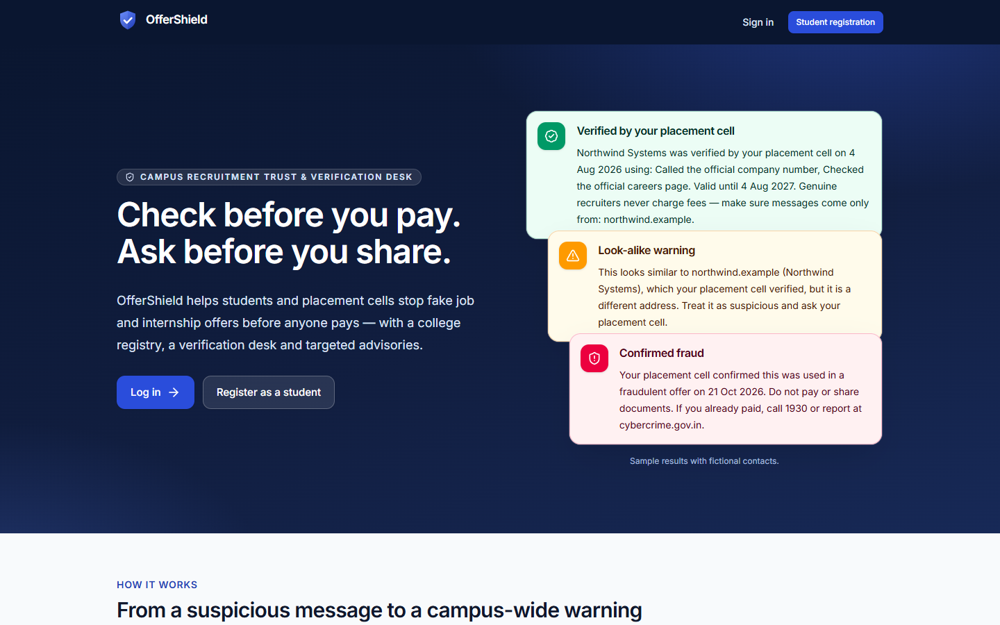
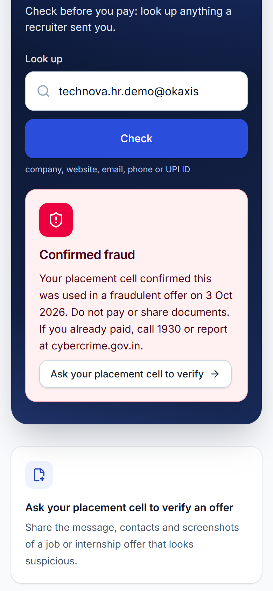
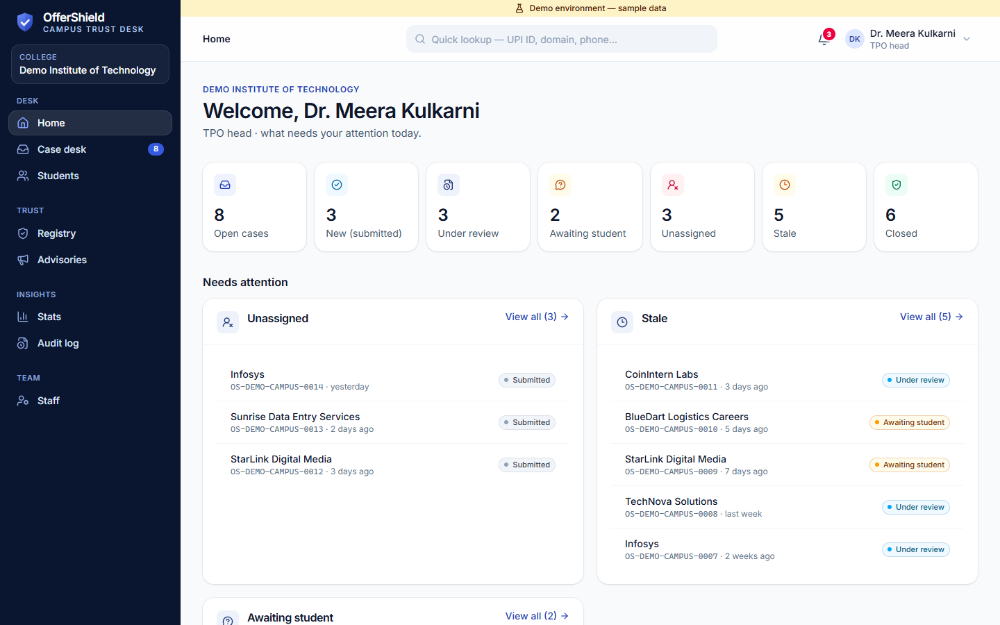
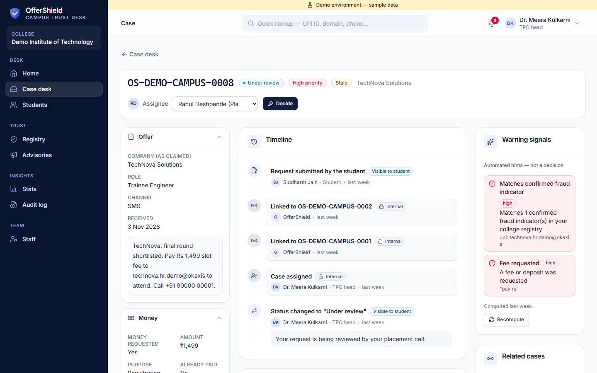
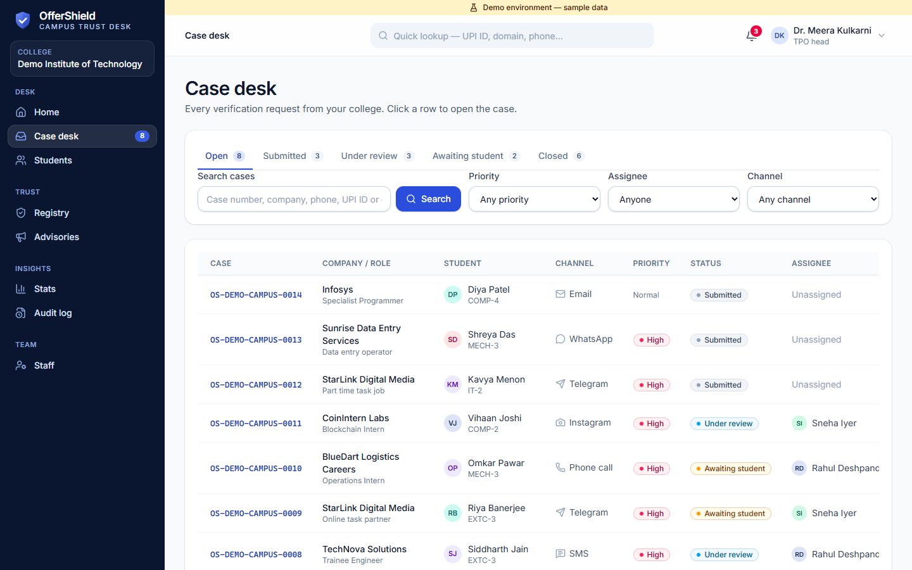
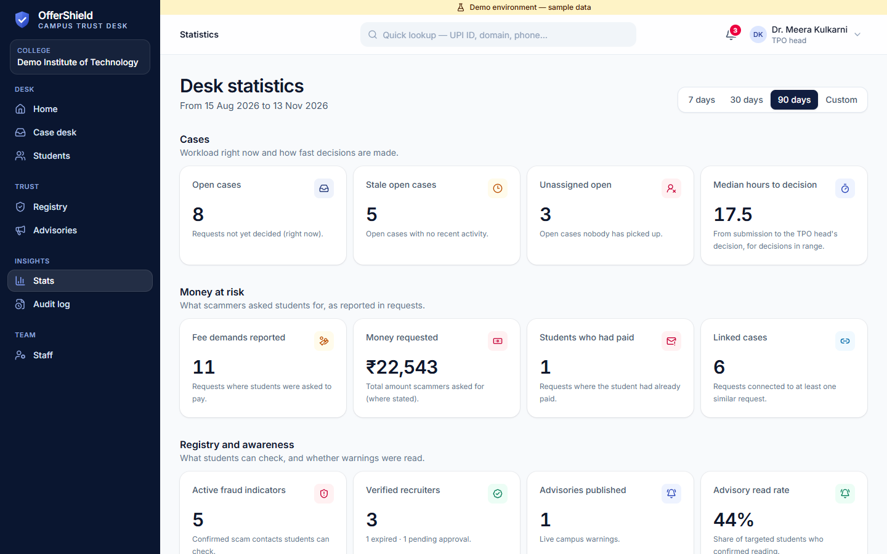

# OfferShield — Campus Trust Desk

OfferShield is a Campus Recruitment Trust & Verification Desk for colleges. Students can search their college's reviewed recruiter records and confirmed suspicious indicators, and submit structured verification requests, with evidence, for suspicious external job or internship offers. Placement staff investigate each request as a case, the TPO head records the final decision with reasons, confirmed findings go into the college's registry, and the TPO publishes targeted advisories to students. It is multi-tenant (one tenant = one college) and is **not** a scam-detecting AI, placement ERP, job portal, recruiter marketplace or ATS — automated checks only assist staff and never decide whether an offer is genuine.

> **Status:** Phases 1–7 passed review; Phase 8 (premium UI redesign) implemented — awaiting architect review. See [docs/PHASE_STATUS.md](docs/PHASE_STATUS.md).
>
> **Live demo:** <URL> (to be added after the Render deployment)

## What it does

- **Students:** "check before you pay" against the college registry → ask the placement cell to verify a suspicious offer with screenshots → follow the request, reply to questions and see the outcome → read targeted advisories and confirm with "I've read this".
- **Placement officers:** triage the case desk (filters, look-alike and fee signals, related cases), request information, keep internal notes, recommend an outcome, draft advisories.
- **TPO head:** record evidence-based decisions, maintain the verified-recruiter and confirmed-fraud registries, publish advisories to the batches at risk, and track impact on the stats page and audit log.
- **What makes it different:** findings come only from accountable TPO-head decisions, are revoked when a case is reopened, stay inside one college, and never certify an offer as "safe".

Pilot features (Phase 7):

- **Colleges without student email:** per-college *manual approval* mode — students register with any email and the placement cell approves them.
- **Staff-assisted password resets** (no email needed) and student account management (approve, reject, bulk approve, disable).
- **Fair rate limits** for a whole campus behind one IP (per user when signed in, per email at login).
- **Privacy notice and terms** with recorded consent; evidence **retention** script.
- **One production service:** Express serves the built client with a strict CSP, HSTS, caching and compression; JSON request logs with request ids; readiness check for Render.
- **Showcase demo college** ("Demo Institute of Technology") with six weeks of realistic, anonymised activity, resettable with one command.

## Screenshots

Showcase data ("Demo Institute of Technology"; every person and scam contact is fictional). More in [docs/screenshots/](docs/screenshots/), at 1440 × 900 and 390 × 844.

| Landing | Student home: confirmed-fraud lookup |
| --- | --- |
|  |  |
| **Staff home** | **Case detail** |
|  |  |
| **Case desk** | **Statistics** |
|  |  |

The design system is documented in [docs/DESIGN_SYSTEM.md](docs/DESIGN_SYSTEM.md).

Guides: [placement cell](docs/GUIDE_PLACEMENT_CELL.md) · [students](docs/GUIDE_STUDENT.md) · [deployment](docs/DEPLOYMENT.md) · [operations](docs/OPERATIONS.md)

## Prerequisites

- Node.js **20 or newer** (22 in production, see `.node-version`) — check with `node -v`
- npm 10 or newer — check with `npm -v`
- Windows PowerShell 5.1+ (commands below), or any shell with equivalent commands

A MongoDB connection string (e.g. MongoDB Atlas) is required for `npm run dev` and the seed scripts. Tests use an in-memory MongoDB (`mongodb-memory-server`); the first test run downloads a MongoDB binary (~520 MB).

## Setup (PowerShell)

```powershell
Set-Location G:\offershield-campus-trust-desk

# 1. Install all workspace dependencies (root, client, server)
npm install

# 2. Create local env files from the examples (only if they do not exist yet)
if (-not (Test-Path server\.env)) { Copy-Item server\.env.example server\.env }
if (-not (Test-Path client\.env)) { Copy-Item client\.env.example client\.env }   # optional; defaults work

# 3. Edit server\.env: set MONGODB_URI, JWT_SECRET (32+ chars) and the SEED_* values, then seed
npm run seed:superadmin -w server
npm run seed:demo -w server     # demo colleges demo-alpha / demo-beta (not in production)
npm run seed:showcase -w server # realistic demo college demo-campus (add -- --reset to rebuild all demo colleges)

# 4. Run API (http://localhost:5000) and client (http://localhost:5173) together
npm run dev
# Stop with Ctrl+C

# 5. Run tests (server then client; exits non-zero on any failure)
npm test
npm run test:server
npm run test:client

# 6. Lint and build
npm run lint
npm run build          # outputs client\dist

# 7. Production mode locally (one service on http://localhost:5000 serving the built client)
npm start              # requires CLIENT_ORIGINS and a real JWT_SECRET; see docs/DEPLOYMENT.md
```

Check the API while `npm run dev` is running:

```powershell
Invoke-RestMethod http://localhost:5000/api/v1/health    # direct
Invoke-RestMethod http://localhost:5173/api/v1/health    # through the Vite dev proxy
```

## Scripts (root)

| Script | What it does |
| --- | --- |
| `npm run dev` | Starts server (nodemon) and client (Vite) together via `concurrently` |
| `npm start` | Production server (`--production`), serving the API and `client/dist` |
| `npm run dev:server` / `npm run dev:client` | Starts one side only |
| `npm test` | Server tests (Jest) then client tests (Vitest) |
| `npm run test:server` / `npm run test:client` | One side only |
| `npm run build` | Production build of the client into `client/dist` |
| `npm run lint` | ESLint on the server, oxlint on the client |
| `npm run seed:superadmin -w server` | Create the super admin from `SEED_SUPERADMIN_*` (idempotent) |
| `npm run seed:demo -w server` | Create demo colleges, staff and students using `SEED_DEMO_PASSWORD` (idempotent) |
| `npm run seed:showcase -w server [-- --reset]` | Create the showcase demo college; `--reset` deletes and rebuilds every `isDemo` college |
| `npm run ops:retention -w server [-- --apply]` | Evidence retention: dry run by default, `--apply` deletes evidence of cases closed more than `RETENTION_MONTHS` ago |

## Project structure

```
offershield-campus-trust-desk/
  package.json          npm workspaces root (client, server)
  docs/                 product, architecture, data model, API, security, decisions, phase status
  server/               Express 5 API (CommonJS)
    src/
      server.js         starts the HTTP listener only
      app.js            builds the Express app (used directly by tests)
      config/env.js     zod-validated configuration (the only place reading process.env)
      routes/           /api/v1 routers
      controllers/      request/response mapping only
      middleware/       authenticate, requireRole, requireTenant, enforcePasswordChange, rate limiters, validate, errors
      utils/AppError.js operational error type
      config/db.js      mongoose connect/disconnect
      models/           College, User, AuditLog
      repositories/     tenantRepository (college-scoped data access)
      services/         auth, admin, staff, audit
      validators/       zod .strict() body schemas
    scripts/            seed-superadmin.js, seed-demo.js, seed-showcase.js, ops-retention.js, lib/ (shared seed and ops helpers)
    tests/              Jest + Supertest
  client/               React + Vite + Tailwind CSS v4
    src/
      api/client.js     the single axios instance
      api/              auth, admin, staff, health
      auth/             AuthProvider, useAuth, roles
      components/       Layout (shell choice), layout/ (public, student and staff shells), ui/ (design system), domain components
      utils/format.js   the only date / money formatter (en-IN)
      pages/            login, register, change password, student/staff/admin pages
      routes/           AppRoutes
      __tests__/        Vitest + Testing Library
```

## Documentation

- [Product scope](docs/PRODUCT_SCOPE.md)
- [Architecture](docs/ARCHITECTURE.md)
- [Data model](docs/DATA_MODEL.md)
- [API contract](docs/API_CONTRACT.md)
- [Security design](docs/SECURITY_DESIGN.md)
- [Decisions (ADRs)](docs/DECISIONS.md)
- [Phase status](docs/PHASE_STATUS.md)
- [Security checklist](docs/SECURITY_CHECKLIST.md)
- [Design system](docs/DESIGN_SYSTEM.md)
- [Deployment (Render + Atlas)](docs/DEPLOYMENT.md)
- [Operations](docs/OPERATIONS.md)
- [Guide for the placement cell](docs/GUIDE_PLACEMENT_CELL.md)
- [Guide for students](docs/GUIDE_STUDENT.md)
