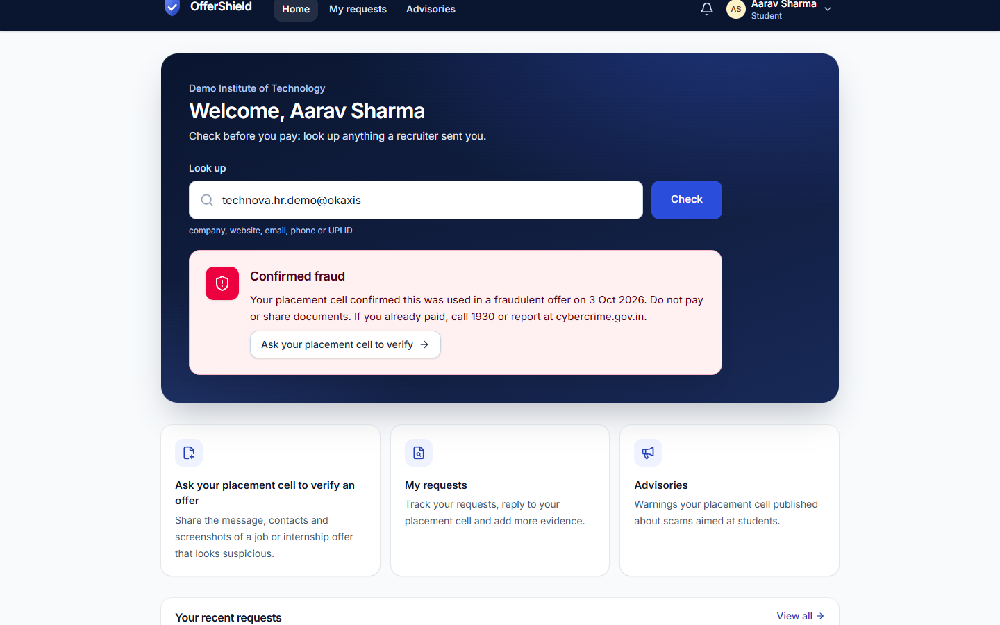
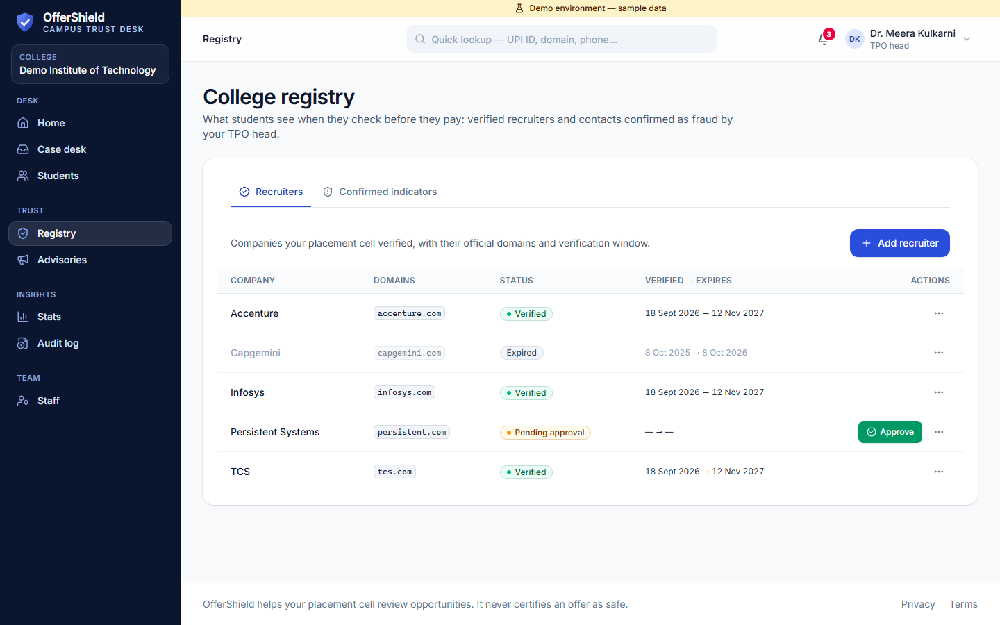
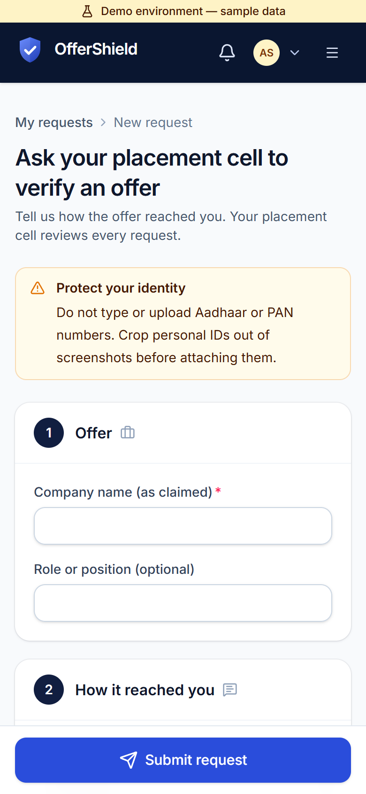
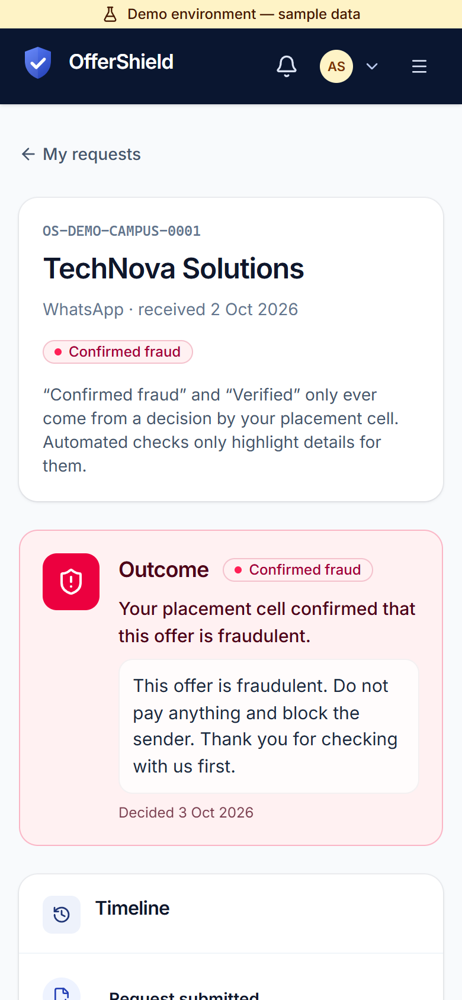
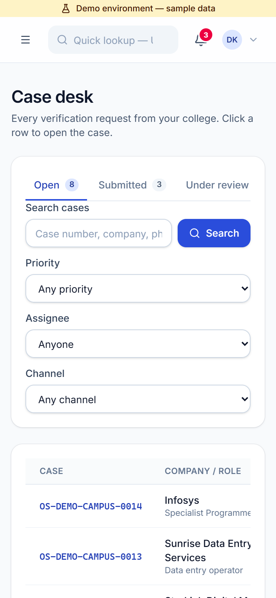
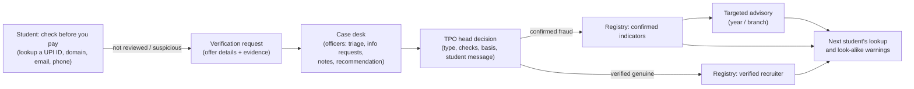
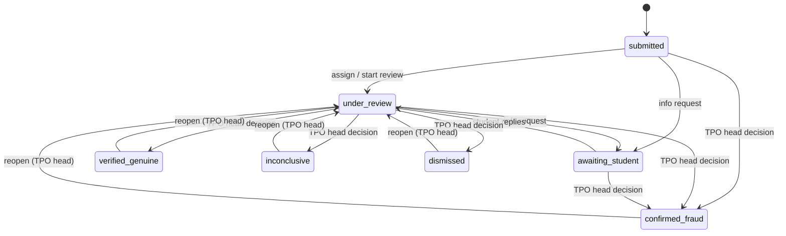
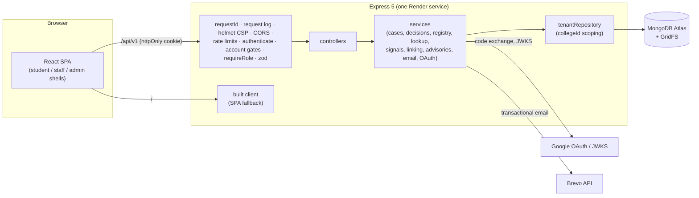

# OfferShield — Campus Recruitment Trust & Verification Desk

> Every "Is this offer real?" question becomes a tracked placement-cell case with a recorded finding — and confirmed findings protect the next student.

## Live demo

**[offershield-l2rk.onrender.com](https://offershield-l2rk.onrender.com)**

The demo runs on Render's free tier, which sleeps when idle: the first page load can take about a minute. Demo accounts (student, placement officer, TPO head) are available on request from the author.

## Screenshots

Showcase data ("Demo Institute of Technology"); every person and scam contact is fictional.

| Landing | Student home: confirmed-fraud lookup | Case desk |
| --- | --- | --- |
|  |  |  |
| **Staff case detail** | **Registry** | **Statistics** |
|  |  |  |

On a phone (390 px):

| Student home | New request | Request outcome | Case desk |
| --- | --- | --- | --- |
|  |  |  |  |

All 26 screenshots (1440 × 900 and 390 × 844) are in [docs/screenshots/](docs/screenshots/).

## The problem

Fake internship and job offers reach Indian students on WhatsApp, Telegram and email, usually asking for a "registration", "training" or "security deposit" fee. Students ask their placement cell whether an offer is real, but the answer is given informally — a call, a message, a word in the corridor — and nothing is recorded. The next student who receives the same scam repeats the same check, and the college never builds up knowledge of what it has already seen.

## What makes it different

OfferShield combines four things:

1. **Structured verification request** — the student submits the offer as a case (company, channel, message, links, contacts, money asked, evidence) instead of an informal question.
2. **Placement-cell case desk** — officers triage, request information, keep internal notes and recommend; the TPO head records an evidence-based decision with a reason.
3. **Allegation vs finding governance** — what a student reports is only an allegation; only a TPO-head decision creates a finding, and reopening a case revokes it.
4. **Campus lookup that turns findings into protection** — confirmed scam contacts and verified recruiters feed a "check before you pay" lookup, look-alike warnings and targeted advisories for the next student.

**Positioning.** Platform-level employer vetting exists elsewhere (for example, Handshake in the US vets employers posting on its own platform). OfferShield targets the opportunities that arrive *outside* official channels — forwarded messages and cold emails — at Indian colleges, and keeps each college's knowledge inside that college.

## How it works



Case statuses (`server/src/services/caseStateMachine.js`); every transition is one atomic conditional update:



Any open status (submitted, under review, awaiting student) can receive any of the four decisions; the diagram shows the most common paths.

## Features by role

| Role | Can do | Cannot do |
| --- | --- | --- |
| **Student** | Look up a UPI ID, domain, email, phone or URL; submit verification requests with evidence (PNG, JPEG, PDF); reply when asked for information; see the outcome and the student-facing message; read and acknowledge advisories for their year and branch; edit their own name, year and branch; choose email preferences | See internal notes, recommendations, signals or other students' requests; see another college's data |
| **Placement officer** | Case desk (filters, search, assignment), info requests, messages, internal notes, recommendations; propose recruiters; draft advisories; approve, reject, enable and disable students; reset student passwords; statistics | Record decisions or reopen cases; approve or suspend recruiters; revoke indicators; publish advisories; read the audit log; promote years |
| **TPO head** | Everything an officer can do, plus: record decisions and reopen cases; approve, renew and suspend verified recruiters; revoke indicators; publish and withdraw advisories; manage officers and reset their passwords; read the audit log; promote students to the next year each June | Act on another college |
| **Super admin** | Create and edit colleges (domains, branches, verification mode), rotate join codes, create TPO heads and reset their passwords | Read case contents, messages, evidence or notes (403 on every staff and student route) |

## Investigation and trust intelligence

- **Indicator extraction** (`services/indicators/`): emails, domains, phone numbers, UPI IDs and URLs are extracted from the message, links and contacts and normalised (lower-case, leading `www.` removed, URLs without fragments or trailing slashes, Indian mobile numbers unified to `+91XXXXXXXXXX`, internationalised domains converted to punycode).
- **Lookup precedence** (`services/lookup.service.js`): five results, checked in this order — `confirmed_fraud` → `lookalike_warning` → `verified` → `verified_expired` → `not_reviewed`. The guidance text never calls anything "safe"; a not-reviewed result says "Not reviewed does not mean safe".
- **Look-alike detection** (`services/registry/similarity.js`, pure, no DNS): compares the registrable domain (via `tldts`, private suffixes such as `github.io` treated as public) with verified recruiter domains using a homoglyph skeleton (Cyrillic/Greek letters and 0/1/3/5 digits), Levenshtein distance ≤ 2 for brand labels of 5+ characters, and brand-token rules (`infosys-careers`, `careersinfosys`).
- **Related-case linking** (`services/linking/`): cases are linked when they share an indicator or when their messages are near-duplicates — a 64-bit SimHash (FNV-1a features) after replacing URLs, emails, UPI IDs, phones, numbers and salutation names with placeholders, so template scams with different names and amounts still match. Default Hamming-distance threshold: 6 (`SIMHASH_MAX_DISTANCE`).
- **Warning signals** (`services/signals/compute.js`, staff-only, never change a status): matches a confirmed indicator, fee requested, already paid, look-alike domain, claimed-company domain mismatch, free-mail sender, messaging-app-only contact, urgency language, documents already shared.
- **Fraud indicator lifecycle**: indicators are published only by a TPO-head `confirmed_fraud` decision, revoked automatically when that case is reopened (or manually by the TPO head), and conflict-checked both ways against verified recruiters (`CONFLICTS_WITH_VERIFIED_RECRUITER` / `CONFLICTS_WITH_FRAUD_INDICATOR`).

## Governance and security

- **Multi-tenant isolation:** `collegeId` comes from the session only; college-owned collections are reached through `tenantRepository.forTenant(collegeId)`, whose `aggregate` refuses pipelines that do not start with the tenant `$match`; another college's records return 404. Dedicated suites: `tenantIsolation`, `staffIsolation`, `registryIsolation`, `tenantRepository`, `tenantAggregate`.
- **RBAC:** four roles enforced by `requireRole` on every router; decisions, reopen, recruiter approval, indicator revocation, advisory publishing, audit log and year promotion are TPO-head only.
- **Allegation vs finding:** student reports never appear as confirmed; only decisions create indicators, and reopening revokes them.
- **Append-only records:** the audit log and internal notes use a Mongoose plugin that rejects updates and deletes; audit metadata is stripped of secret-like keys.
- **Evidence handling:** file type checked by magic bytes, EXIF/location metadata stripped from images, stored in GridFS, downloaded only through a short-lived signed link plus a valid session, served with `Content-Security-Policy: sandbox` and `nosniff`.
- **Privacy guard:** PAN numbers and Aadhaar numbers (Verhoeff checksum) are rejected in submitted text.
- **No SSRF:** submitted URLs are never fetched.
- **Strict CSP and HSTS** (`script-src 'self'`, `frame-ancestors 'none'`; no third-party scripts, fonts or frames), helmet defaults including `Referrer-Policy: no-referrer`.
- **Fair rate limits:** per account when signed in (a whole campus can share one IP), per IP + email at login, per IP at registration, per address for password resets.
- **Logs:** one JSON line per request without query strings, bodies or cookies; errors logged by code; email failures logged as `{event: "email_send", errorCode, providerStatus}` only.
- **Template-only messages:** in-app notifications and emails are rendered from allow-listed fields; they never contain decision bases, internal notes, signals or other students' data.
- **DPDP-minded data minimisation:** lookups record only the query type and result, never the text; no ID numbers collected; consent recorded with the policy version; evidence of closed cases deleted after `RETENTION_MONTHS` by `ops:retention`.

## Production readiness (Phase 9)

- **Google sign-in:** server-side OAuth 2.0 / OpenID Connect authorization-code flow with PKCE (S256), `state` and `nonce` in a signed httpOnly cookie, ID-token verification against Google's JWKS with `node:crypto` (no SDK), issuer/audience/expiry/nonce/`email_verified` checks, linking of existing accounts by verified email, and college domain rules (`email_domain` colleges require the Google address or Workspace domain to match; `manual_approval` colleges approve each student).
- **Email (Brevo HTTP API):** 6-digit verification codes for password sign-ups (HMAC-stored, 10 minutes, 5 attempts), self-service password reset (hashed single-use 30-minute tokens in the URL fragment, all sessions ended), notification emails for case updates, advisories and staff alerts with per-user preferences, a daily budget with a reserve for critical mail, an `EmailLog` without content, and `ops:email-test` for diagnosis.
- **Operations:** manual student approval, staff-assisted password resets, academic-year promotion, showcase demo data with a one-command reset (`seed:showcase -- --reset`), evidence retention script, `ops:backfill-email-verified` for rollout, graceful shutdown on SIGTERM, `/api/v1/health` and `/api/v1/health/ready`, startup validation that names missing keys without printing values.

## Engineering quality

| Metric | Value |
| --- | --- |
| Server tests (Jest + Supertest + mongodb-memory-server) | 494 tests in 44 suites, including tenant-isolation, RBAC and security suites |
| Client tests (Vitest + Testing Library) | 105 tests in 20 files |
| Phases delivered | 9 phases, each architect-reviewed (Phase 9.1 fixes awaiting review) — see [PHASE_STATUS](docs/PHASE_STATUS.md) |
| Architecture decision records | 63 ([DECISIONS.md](docs/DECISIONS.md)) |
| Production dependency audit | `npm audit --omit=dev`: 0 vulnerabilities |
| Main JS bundle | 375.15 kB (111.02 kB gzip); staff and admin pages are lazy-loaded |
| CSP violations in the production smoke | 0 (30 page checks at 1440 and 390 px, production build) |

## Tech stack

- **Client:** React 19, Vite 8, Tailwind CSS v4, React Router 7, lucide-react icons, self-hosted Inter.
- **Server:** Node.js 22, Express 5, Mongoose 9, MongoDB Atlas (GridFS for evidence), zod validation, bcrypt, jsonwebtoken, helmet, express-rate-limit, tldts.
- **Testing:** Jest, Supertest, mongodb-memory-server, Vitest, Testing Library.
- **Services:** Render (single web service), Brevo (transactional email), Google OAuth.

Dependencies are kept deliberately small: no authentication SDKs (Google and Brevo are called over HTTPS directly), no UI component kit, no chart library.

## Architecture



```text
offershield-campus-trust-desk/
├── client/                 React app (Vite)
│   └── src/
│       ├── api/            one module per API area (single axios client)
│       ├── auth/           session context, roles, account gates
│       ├── components/     ui/ design system, layout/ shells, domain components
│       ├── pages/          one file per route
│       └── __tests__/      Vitest suites
├── server/                 Express API
│   ├── src/
│   │   ├── config/         validated environment (the only process.env reader)
│   │   ├── routes/ → controllers/ → services/ → repositories/ → models/
│   │   ├── middleware/     auth, gates, rate limits, validation, errors
│   │   └── services/       indicators, registry, signals, linking, email, oauth, …
│   ├── scripts/            seeds and ops scripts
│   └── tests/              Jest suites
└── docs/                   architecture, API, data model, security, operations, ADRs
```

## Getting started (Windows PowerShell)

Prerequisites: Node.js 20 or newer (22 in production, see `.node-version`), npm 10+, and a MongoDB connection string (for example a free MongoDB Atlas cluster). Tests do not need a database: they start an in-memory MongoDB (the first run downloads a MongoDB binary).

```powershell
git clone <repository-url> offershield-campus-trust-desk
Set-Location offershield-campus-trust-desk
npm install

Copy-Item server\.env.example server\.env
Copy-Item client\.env.example client\.env
# Edit server\.env: MONGODB_URI, JWT_SECRET, SEED_SUPERADMIN_EMAIL, SEED_SUPERADMIN_PASSWORD

npm run seed:superadmin -w server   # the platform super admin
npm run seed:showcase -w server     # optional: the fictional demo college with six weeks of activity

npm run dev                         # API on :5000, client on http://localhost:5173
npm test                            # server then client tests
```

Environment variables (names only; see `server/.env.example` and [DEPLOYMENT.md](docs/DEPLOYMENT.md)):

- Required: `MONGODB_URI`, `JWT_SECRET`, `CLIENT_ORIGINS` (production)
- Recommended: `APP_BASE_URL`, `SUPPORT_EMAIL`, `RETENTION_MONTHS`, `TRUST_PROXY`
- Email (optional): `EMAIL_PROVIDER`, `BREVO_API_KEY`, `EMAIL_FROM`, `EMAIL_FROM_NAME`, `EMAIL_DAILY_BUDGET`, `REQUIRE_EMAIL_VERIFICATION`
- Google sign-in (optional): `GOOGLE_CLIENT_ID`, `GOOGLE_CLIENT_SECRET`, `GOOGLE_REDIRECT_URI`
- Tuning: `JWT_EXPIRES_IN`, rate-limit variables, `CASE_CREATE_LIMIT_PER_HOUR`, `LOOKUP_LIMIT_PER_10MIN`, `SIMHASH_MAX_DISTANCE`, `CASE_STALE_DAYS`, `EVIDENCE_LINK_TTL_SECONDS`, `RECRUITER_VERIFICATION_DAYS`
- Seeds only: `SEED_SUPERADMIN_EMAIL`, `SEED_SUPERADMIN_PASSWORD`, `SEED_DEMO_PASSWORD`, `ALLOW_DEMO_SEED`

Scripts:

| Script | What it does |
| --- | --- |
| `npm run dev` | Server (nodemon) and client (Vite) together |
| `npm start` | Production server serving the API and `client/dist` |
| `npm test` / `npm run test:server` / `npm run test:client` | Tests |
| `npm run lint` · `npm run build` | ESLint + oxlint · client production build |
| `npm run seed:superadmin -w server` | Create the super admin (idempotent) |
| `npm run seed:demo -w server` | Two small demo colleges (idempotent) |
| `npm run seed:showcase -w server [-- --reset]` | Showcase demo college; `--reset` rebuilds every `isDemo` college only |
| `npm run ops:retention -w server [-- --apply]` | Evidence retention (dry run by default) |
| `npm run ops:backfill-email-verified -w server` | Phase 9 rollout: mark existing accounts verified (idempotent) |
| `npm run ops:email-test -w server -- --to <address>` | Send one test email; prints only `ok` or the error code |

For production on Render (Atlas, environment, Google Cloud, Brevo DNS, rollout order, custom domain) see [docs/DEPLOYMENT.md](docs/DEPLOYMENT.md).

## Documentation

| Document | Contents |
| --- | --- |
| [PRODUCT_SCOPE.md](docs/PRODUCT_SCOPE.md) | Problem, users, scope and non-goals |
| [ARCHITECTURE.md](docs/ARCHITECTURE.md) | Components, request pipeline, module boundaries |
| [API_CONTRACT.md](docs/API_CONTRACT.md) | Every route with roles, success and error codes |
| [DATA_MODEL.md](docs/DATA_MODEL.md) | Collections, fields and indexes |
| [SECURITY_DESIGN.md](docs/SECURITY_DESIGN.md) | Security controls by phase |
| [SECURITY_CHECKLIST.md](docs/SECURITY_CHECKLIST.md) | Each control mapped to the test that proves it |
| [DECISIONS.md](docs/DECISIONS.md) | 63 architecture decision records |
| [DESIGN_SYSTEM.md](docs/DESIGN_SYSTEM.md) | Tokens, layouts, components and UI rules |
| [DEPLOYMENT.md](docs/DEPLOYMENT.md) | Render, Atlas, Google Cloud, Brevo, rollout |
| [OPERATIONS.md](docs/OPERATIONS.md) | Onboarding, resets, email troubleshooting, retention, incidents |
| [GUIDE_PLACEMENT_CELL.md](docs/GUIDE_PLACEMENT_CELL.md) | Guide for placement officers and TPO heads |
| [GUIDE_STUDENT.md](docs/GUIDE_STUDENT.md) | Guide for students |
| [PHASE_STATUS.md](docs/PHASE_STATUS.md) | Delivery status and test evidence per phase |
| [RELEASE_NOTES.md](docs/RELEASE_NOTES.md) | v1.0.0 release notes |
| [screenshots/](docs/screenshots/) | 26 screenshots at desktop and phone widths |

## Roadmap

- Microsoft sign-in for colleges on Outlook / Microsoft 365.
- Opt-in sharing of confirmed fraud indicators between colleges.
- Evidence-pack PDF export for police or cybercrime reports.
- CSV import of student rosters.
- Scheduled retention and automated backups.

## Known limitations

- The free hosting tier sleeps when idle; the first request after a pause is slow.
- Rate-limit counters and the email-budget reservation are in memory, sized for a single instance.
- MongoDB Atlas M0 (free) has no backups; [OPERATIONS.md](docs/OPERATIONS.md) describes manual exports.
- Look-alike and related-case detection are heuristics that assist staff; they can miss or over-flag, and never change a case on their own.

## Author

**Samarth Burkul** — final-year Computer Engineering student.
GitHub: [SamarthBurkul](https://github.com/SamarthBurkul) · LinkedIn: `<add LinkedIn URL>`

## License

All rights reserved. Contact the author for use.
