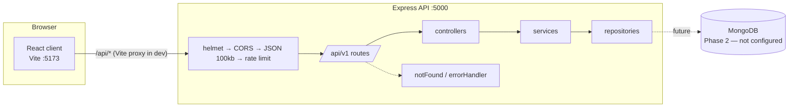

# Architecture

## Monorepo layout

npm workspaces with two packages:

| Package | Stack | Purpose |
| --- | --- | --- |
| `server/` | Node.js 20+, Express 5, CommonJS | REST API under `/api/v1` |
| `client/` | React 19, Vite, Tailwind CSS v4, React Router, axios | Browser UI |

The root `package.json` only orchestrates (`dev`, `test`, `build`, `lint`) and holds `concurrently`. Each package owns its dependencies.

## Server request pipeline

`server/src/app.js` builds the app in this exact order:

1. `app.disable('x-powered-by')`
2. `helmet()` — security headers
3. `cors()` — allow-list from `CLIENT_ORIGINS`, `credentials: true`; requests without an `Origin` header are allowed; a disallowed origin receives no CORS headers (no error, no crash)
4. `express.json({ limit: '100kb' })`
5. Baseline rate limiter on `/api`
6. *(Phase 2, planned)* authentication → tenant resolution → RBAC, mounted per router
7. Routes at `/api/v1`
8. `notFound` — 404 envelope
9. `errorHandler` — maps errors to the standard envelope

`app.js` never listens. `server.js` imports the app and calls `listen`, so tests use Supertest against `app.js` with no open ports.

## Layering

```
routes → controllers → services → repositories → models
```

- **routes**: URL + HTTP method → middleware chain → controller. No logic.
- **controllers**: map request to service input and service output to response. No business logic.
- **services**: business rules (case transitions, decision rules, registry updates).
- **repositories**: all database queries; every query on college-owned data takes a `collegeId`.
- **models**: Mongoose schemas (Phase 2+).
- **validators**: zod schemas for request bodies/params (Phase 2+).

Phase 1 only has the health route/controller; `models/`, `repositories/`, `services/` and `validators/` are empty placeholders.

## Tenant and RBAC middleware (Phase 2, planned)

- `authenticate` reads the JWT from an httpOnly cookie and attaches `req.user` (`id`, `role`, `collegeId`).
- `tenantContext` takes `collegeId` **only** from the authenticated session (never from body, query or params) and passes it down to services/repositories.
- `authorize(...roles)` restricts routes by role; ownership rules (a student sees only their own cases) are enforced in services/repositories.
- These run after the global pipeline (steps 1–5) and before the feature routers.

## Configuration

`server/src/config/env.js` loads `server/.env` via dotenv, validates it with zod and exports a frozen config. It is the only server module that reads `process.env` (enforced by an ESLint rule). Invalid configuration throws at startup with the list of invalid keys, never their values.

## Development proxy and cookie strategy

- The Vite dev server (port 5173) proxies `/api` to `http://localhost:5000`.
- The client calls relative URLs (`/api/v1/...`) through a single axios instance (`client/src/api/client.js`) with `withCredentials: true` and a 10 s timeout.
- Because the browser sees the API as same-origin in development, httpOnly, `SameSite=Lax` auth cookies (Phase 2) work without cross-site cookie configuration.
- In production the client and API should also be served from one origin (reverse proxy); `CLIENT_ORIGINS` remains as a strict CORS allow-list for any other origin.

## Diagram


