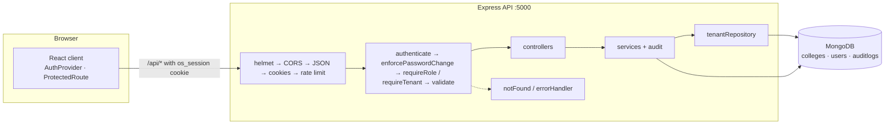

# Architecture

## Monorepo layout

npm workspaces with two packages:

| Package | Stack | Purpose |
| --- | --- | --- |
| `server/` | Node.js 20+, Express 5, CommonJS, Mongoose 9 | REST API under `/api/v1` |
| `client/` | React 19, Vite, Tailwind CSS v4, React Router, axios | Browser UI |

The root `package.json` only orchestrates (`dev`, `test`, `build`, `lint`) and holds `concurrently`. Each package owns its dependencies.

## Server request pipeline

Middleware order, as implemented:

```
helmet → cors → express.json (100kb) → cookieParser → rate limit (/api)
  → [/api/v1 router]
      → authRateLimiter (login, register only)
      → authenticate → enforcePasswordChange → requireRole / requireTenant
      → validators (zod .strict())
      → controller → service → tenant repository → model
  → notFound → errorHandler
```

`server/src/app.js` builds the app in this order:

1. `app.disable('x-powered-by')`
2. `helmet()` — security headers
3. `cors()` — allow-list from `CLIENT_ORIGINS`, `credentials: true`
4. `express.json({ limit: '100kb' })`
5. `cookieParser()`
6. Baseline rate limiter on `/api`
7. `createApiRouter(config)` at `/api/v1` — each feature router applies, per route or router:
   - `authRateLimiter` on `POST /auth/login` and `POST /auth/register`
   - `authenticate` (verify JWT cookie, reload the user, set `req.user`)
   - `enforcePasswordChange` (temporary-password allow-list)
   - `requireRole(...)` and/or `requireTenant` (sets `req.tenant = { collegeId }` from `req.user`)
   - `validateBody(schema)`
   - controller
8. `notFound` — 404 envelope
9. `errorHandler` — maps errors to the standard envelope

Routers are built per app instance (`createApp(config)`), so tests can create apps with their own secret and rate limits. `app.js` never listens and never connects to MongoDB; `server.js` calls `connectDB(MONGODB_URI)` first, exits with code 1 (URI not printed) on failure, then listens.

| Router | Router-level middleware |
| --- | --- |
| `/health` | none |
| `/auth` | per route: limiter + validator (`register`, `login`); none (`logout`); `authenticate`, `enforcePasswordChange` (`me`, `change-password`) |
| `/admin` | `authenticate`, `enforcePasswordChange`, `requireRole('super_admin')` |
| `/college` | `authenticate`, `enforcePasswordChange`, `requireTenant` |
| `/staff` | `authenticate`, `enforcePasswordChange`, `requireTenant`, then per route `requireRole('tpo_head', 'placement_officer')` or `requireRole('tpo_head')` |
| `/cases` | `authenticate`, `enforcePasswordChange`; per route `requireRole('student')` + `requireTenant` (+ `caseRateLimiter` on create, `validateBody`/`validateQuery`, and for uploads an ownership check **before** `upload` (multer)); the evidence-link route uses `requireTenant` + `requireRole('student', 'placement_officer', 'tpo_head')` |
| `/files` | `authenticate`, `enforcePasswordChange`; the controller verifies the link token against the session user |

## Layering

```
routes → controllers → services → repositories → models
```

- **routes**: URL + method → middleware chain → controller. No logic.
- **controllers**: map request to service input and service output to response; set/clear the session cookie. No Mongoose calls.
- **services** (`auth`, `admin`, `staff`, `audit`, `case`, `evidence`, `storage` (GridFS wrapper), `indicators/`): business rules and audit writes after successful actions.
- **repositories**: `tenantRepository` wraps every college-owned model (`repositories/index.js` exports `userRepository`, `counterRepository`, `caseRepository`, `caseEventRepository`, `evidenceRepository`). All college-scoped reads and writes go through it.
- **models**: Mongoose schemas `College`, `User`, `AuditLog`, `Counter`, `Case`, `CaseEvent`, `Evidence` (+ GridFS bucket `evidence`).
- **validators**: zod `.strict()` body schemas.
- **utils**: `password` (bcrypt + policy), `jwt` (sign/verify, cookie options), `tokens` (join codes, temporary passwords), `safeUser` (the single `toSafeUser()` mapper).

Documented exceptions to "models only via repositories":

- `College` is the tenant itself (platform-level), used directly by the auth and admin services.
- Identity lookups before a tenant is known: login by unique email, session reload by the verified JWT `sub`, email-uniqueness checks.
- Super admin staff counts across colleges (`User.aggregate`).
- `AuditLog` writes in `audit.service`.

## Tenant and RBAC

- `authenticate` sets `req.user` (safe user) from the database, never from token claims alone.
- `requireTenant` takes `collegeId` **only** from `req.user` and refuses `super_admin`.
- `requireRole(...roles)` restricts routes by role → `403 FORBIDDEN`.
- Services call `userRepository.forTenant(req.tenant.collegeId)`; another college's record is indistinguishable from a missing one (404).

## Client

- `AuthProvider` (`src/auth/AuthContext.jsx`) loads `/auth/me` on start and exposes `user`, `college`, `loading`, `login`, `register`, `logout`, `refresh` via `useAuth()`.
- `ProtectedRoute allowedRoles={…}`: unauthenticated → `/login`; `mustChangePassword` → `/change-password`; wrong role → Forbidden page.
- API modules `api/auth.js`, `api/admin.js`, `api/staff.js` all use the single axios instance (`api/client.js`).
- Routes: `/`, `/login`, `/register`, `/change-password`, `/student`, `/student/requests`, `/student/requests/new`, `/student/requests/:id`, `/staff`, `/staff/members`, `/admin`, `/admin/colleges/:id`. After login: student → `/student`, staff → `/staff`, super admin → `/admin`.

## Configuration

`server/src/config/env.js` loads `server/.env` via dotenv (skipped when `NODE_ENV=test`), validates it with zod and exports a frozen config. It is the only server module that reads `process.env` (ESLint rule). `MONGODB_URI` and `JWT_SECRET` are required in development and production.

## Development proxy and cookie strategy

- The Vite dev server (5173) proxies `/api` to `http://localhost:5000`, so the browser sees the API as same-origin and the `SameSite=Lax` cookie just works.
- Production (Phase 7, ADR-015): one Render web service serves both the built client and the API from one origin.

## Diagram


